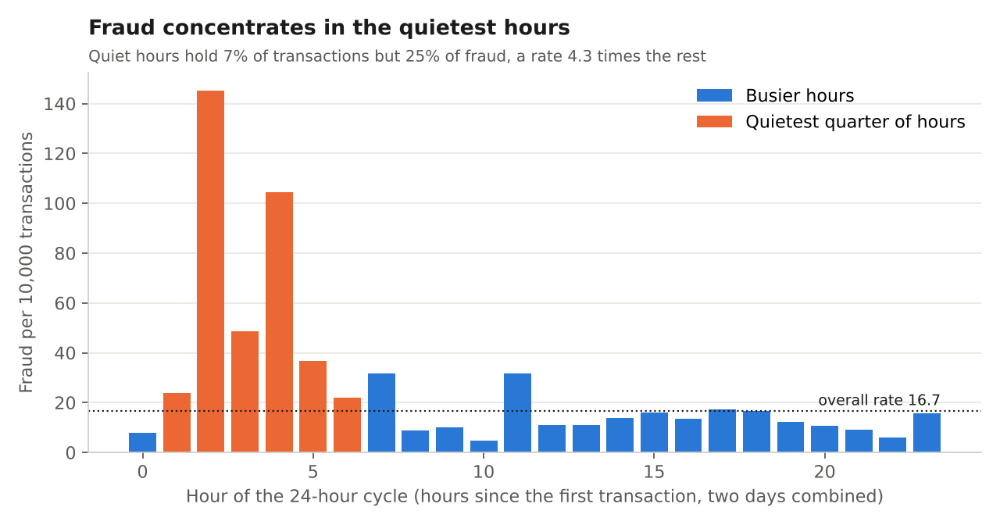
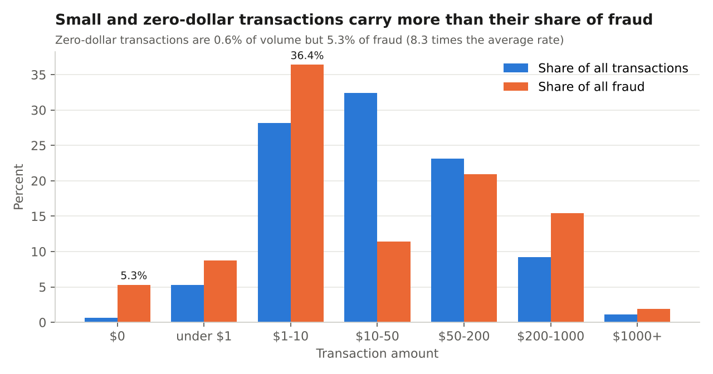
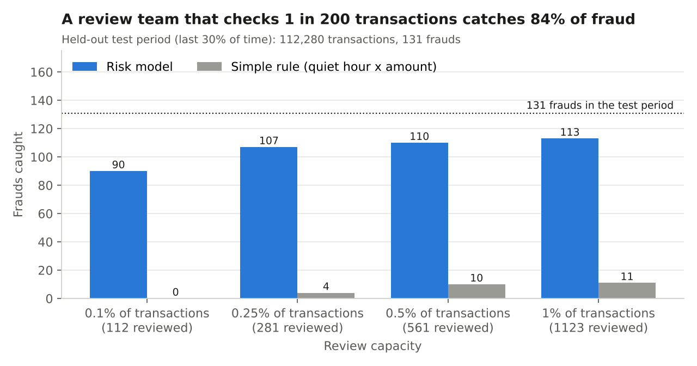
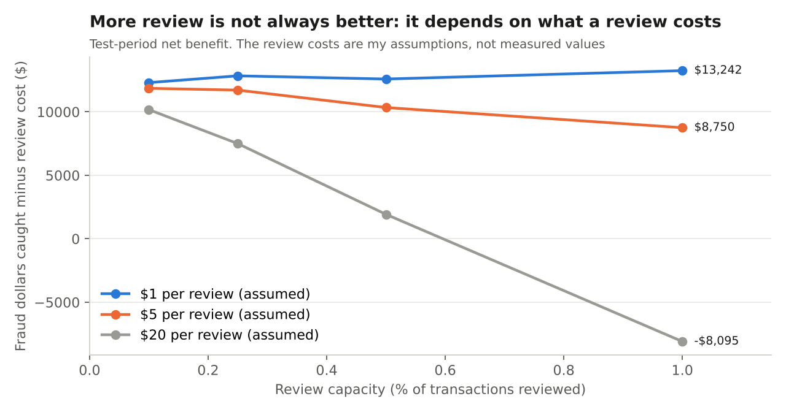

# Card Transaction Fraud: Risk Metrics, Detection and Review Capacity

**The question:** if a fraud team can only review a small slice of transactions, which ones should it review, how much fraud does that catch, and what is each extra review worth?

I answered it on a real public dataset of 283,726 card transactions (473 fraud) by auditing and cleaning the data in SQL, defining the fraud KPIs, finding where fraud concentrates, and testing a risk model on a later period it never saw.

> **Scope, plainly:** this is card fraud from 2013, not freight or logistics. The method (metrics, imbalanced data, review capacity, cost trade-offs) transfers to any fraud-prevention team. The dataset has no card, account or merchant IDs and its 28 features are anonymized, so it cannot show link or velocity patterns, and I cannot explain what the model is reacting to.

## The result in four lines

| | |
|---|---|
| **Review 1 in 200 transactions (0.5%)** | catches **110 of 131** frauds in the test period (84%, 95% interval 78% to 90%) |
| **Review 1 in 1,000 (0.1%)** | catches 90 frauds with 80% precision (4 in 5 flagged transactions are fraud) |
| **Against a simple rule** (quiet hour x amount band) | the rule finds 10 frauds at the same 0.5% capacity, so the model finds 11 times as many |
| **Cost of the extra reviews** | going from 0.1% to 0.5% adds 20 frauds for 449 more reviews, about $1.63 of fraud dollars per added review |

## What the data shows

### 1. Fraud concentrates in the quietest hours


The quietest quarter of hours holds 7.1% of transactions but 24.9% of fraud, a fraud rate of 58.2 versus 13.5 per 10,000 everywhere else (4.3 times). Three of the 48 hours hold 19.7% of all fraud.

### 2. Small and zero-dollar transactions carry more than their share


Zero-dollar transactions are 0.6% of volume but 5.3% of fraud (8.3 times the average rate). They lose no money themselves, so they are a warning sign rather than a loss. Transactions of $1 to $10 are 28.2% of volume and 36.4% of fraud.

### 3. A small review team catches most of the fraud


The model ranks every transaction by risk and the team reviews from the top down. The simple rule I could write in SQL (quiet hour x amount band) cannot rank within a segment and finds almost nothing. Precision-recall detail is in `outputs/pr_curve.png`.

### 4. More review is not always worth it


Net benefit is fraud dollars caught minus the cost of reviewing. **The review costs ($1, $5, $20) are my assumptions, not measured values.** At $20 per review, checking 1% of transactions loses money. At $5, the best capacity tested is the smallest.

## Recommendations

1. **Start the review queue at 0.1% to 0.25% of transactions, not 0.5% or more.** At 0.25% the team catches 107 of 131 frauds. Past that the return drops sharply: from 0.25% to 0.5% the team reviews 280 more transactions and catches 3 more frauds. Set the final capacity from the real cost of one review, since a review is only worth it when it recovers more than it costs.
2. **Track fraud rate by hour as a standing KPI with an alert threshold.** The quietest hours run at 4.3 times the normal rate, so low-volume periods deserve a lower review threshold or an extra verification step. This is two days of data, so confirm it on a longer period before acting on it.
3. **Treat zero-dollar transactions as a review-priority rule.** Their fraud rate is 8.3 times the average. The data cannot confirm why, so I would test whether it is card testing before building a rule around it.
4. **Put the data-quality checks in front of the model.** Three of seven checks raised alerts (duplicates, zero amounts, very large amounts). I removed 1,081 exact duplicates, and 19 of them were fraud, so a team needs a decision on whether duplicates are retries or errors.
5. **Ask for card, account and merchant IDs next.** They unlock velocity and link analysis, which this dataset cannot test.

## KPIs I would put on a fraud dashboard

| KPI | Definition | Value here |
|---|---|---|
| Fraud rate (bps) | fraud transactions / transactions x 10,000 | 16.67 |
| Fraud dollar rate (bps) | fraud amount / total amount x 10,000 | 23.34 |
| Precision at capacity | frauds among reviewed / reviewed | 80.4% at 0.1% |
| Recall at capacity | frauds caught / all frauds | 68.7% at 0.1%, 84.0% at 0.5% |
| Alerts per fraud | transactions reviewed / frauds caught | 1.2 at 0.1%, 5.1 at 0.5% |
| Net benefit | fraud dollars caught - review cost x reviewed | depends on review cost |
| Data-quality alerts | checks over threshold | 3 of 7 |

Example goal (my framing): catch 80% or more of fraud while reviewing no more than 0.5% of volume, keep alerts per fraud at 6 or fewer, and leave no high-severity data-quality alert open for more than a day. The planned dashboard is described in `docs/DASHBOARD_SPEC.md`.

## How it works
1. **Data-quality audit in SQL** (`sql/01_dq_checks.sql`): 7 checks with thresholds and severity. Three raise alerts: 1,081 exact duplicate rows (0.38%), 1,825 zero-amount transactions (0.64%), 55 amounts above $5,000.
2. **Cleaning** (`sql/02_clean.sql`): keeps the first copy of each duplicate. Zero amounts are kept and flagged because they turned out to matter.
3. **Fraud KPIs in SQL** (`sql/03_kpis.sql`): fraud rate, fraud dollar rate, and fraud by amount band and by hour.
4. **Detection** (`src/run_pipeline.py`): logistic regression and gradient boosting against the transparent segment rule, trained on the first 70% of time and tested on the last 30%. Results use fixed review capacities with bootstrap confidence intervals. Logistic regression (PR-AUC 0.742) and gradient boosting (0.733) are not meaningfully different.
5. **Charts** (`src/make_charts.py`): builds the images above from the CSV files in `outputs/`.

## Run it
```
pip install -r requirements.txt
# put creditcard.csv in data/ (see data/README.md)
python src/run_pipeline.py     # about 40 seconds, deterministic
python src/make_charts.py      # rebuilds docs/images
```

## Limits
- Two days of 2013 European card data; fraud patterns today differ.
- Only 131 test-period frauds, so every test figure is uncertain. The intervals show it.
- Anonymized features: I can rank transactions but not explain why.
- No entity IDs, so no velocity, link or account-takeover analysis.
- "Hour of cycle" is hours since the first transaction, because the real start time is not given.
- Removing exact duplicates was a judgment call; some may be genuine retries. I removed and counted them.
- The review-cost figures are assumptions, and the dollar-per-review figure above uses test-period fraud dollars only.

Full numbers and definitions are in `docs/FINDINGS.md`. The data source is described in `data/README.md`.
